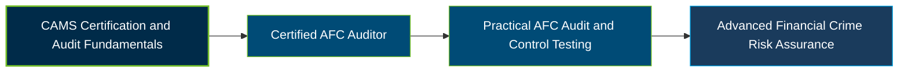

# ACAMS Certified AFC Auditor (Advanced CAMS-Audit) Certification Exam Guide

A dedicated, comprehensive study guide and audit reference repository for candidates preparing for the **ACAMS Certified AFC Auditor Certification Exam**, formerly known as Advanced CAMS-Audit.

---

## Exam Overview

The ACAMS Certified AFC Auditor Certification validates advanced knowledge of anti-financial crime (AFC) auditing, risk-based audit planning, control testing, and the evaluation of financial crime compliance programs.

- **Exam Format**: Computer-based examination with multiple-choice, multiple-select, and case-based questions.
- **Target Audience**: Internal and External Auditors, AML Audit Professionals, AFC Compliance Specialists, Compliance Monitoring Teams, and Financial Crime Control Testers.
- **Prerequisites**: Active ACAMS membership and a passed CAMS certification.

---

## Core Exam Domains & Knowledge Areas

### 1. Corporate Governance and the Audit Function

- Understand corporate governance and the role of the third line of defense in AFC oversight.
- Assess audit independence, responsibilities, and coordination with compliance and risk functions.
- Evaluate business operations, regulatory requirements, and financial crime risk controls.

### 2. Planning and Scoping

- Define audit objectives, scope, and risk-based priorities.
- Review risk assessments, previous audits, regulatory examinations, and relevant documentation.
- Identify significant financial crime risks and determine appropriate audit procedures.

### 3. Fieldwork and Evaluation

- Collect and analyze evidence through interviews, document reviews, and data testing.
- Review and test AFC policies, procedures, internal controls, and monitoring activities.
- Evaluate control effectiveness, validate weaknesses, and support findings with evidence.

### 4. Reporting, Recommendations, and Follow-Up

- Communicate audit findings, conclusions, and control weaknesses clearly.
- Develop practical recommendations that address identified risks and root causes.
- Track corrective actions and assess whether remediation improves control effectiveness.

---

## Certification Path

The following diagram illustrates a suggested professional development progression, not an official ACAMS certification pathway.

---

## Recommended Practice & Study Resources

To prepare effectively, combine official ACAMS study materials with practical audit exercises and established internal audit guidance.

- **CertsGate**: Explore [Advanced CAMS-Audit preparation resources](https://certsgate.com/exams/acams/advanced-cams-audit) for supplementary study materials and practice questions covering AFC audit planning, control testing, and reporting.
- **Practical Study Resource**: Consult the [Institute of Internal Auditors](https://www.theiia.org/en/standards/) for internal audit standards and apply risk-based audit planning, evidence evaluation, control testing, and follow-up to sample AFC audit scenarios.
